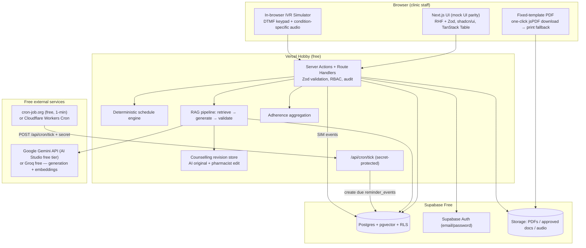
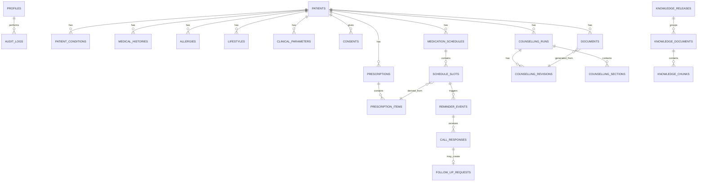

# Arundhati Hospital — Patient Counselling & Medication Adherence System

**End-to-end MVP build plan — zero-cost stack, aligned to the supplied mock UI**

| Document control | Value |
| --- | --- |
| Version | 2.1 — **decisions locked** |
| Date | 2026-11-21 |
| Status | Approved for build — all 8 stakeholder decisions incorporated |
| Sources | `patient_counselling_medication_adherence_workflow.pdf` (extracted text) + supplied mock UI image + stakeholder decision list |
| Change in v2.0 | Every paid component replaced with a free tier or open-source alternative; UI section added from the mock; seeded data matches the mock's Ramesh Kumar example |
| Change in v2.1 | 8 fixed sidebar labels; permanent "DEMO MODE · SIMULATED DATA" badge; one-click PDF download preferred with print fallback; English-only first (language-ready); pharmacist edit/approve/reject with both versions retained; condition-specific IVR option 3; timestamped consent checkbox; clinical corpus approval/versioning by appointed clinical lead |
| Target | Working **end-to-end prototype with synthetic test data** at **₹0 / $0 tool cost** |
| Deployment | Vercel Hobby (free) + Supabase free tier |

> **Ground rules for this version**
>
> 1. **No paid services. No credit card. No trial credits that run out.** Everything below has a genuine free tier (or is open source / self-hosted in the browser).
> 2. **No real patient data.** Synthetic personas only until Phase 3.
> 3. **Real outbound PSTN calls are not free anywhere.** Therefore the free MVP implements an **in-browser IVR simulator** that exercises the identical call flow, keypad logic, retries, event storage and dashboard maths. A provider adapter keeps the door open for a real carrier later — but no carrier is required or paid for in this MVP.
> 4. **The mock UI is the design contract.** Screens, labels, colours and the seeded example (Ramesh Kumar / PNT1001 / Amlodipine / 24-of-30 / 80%) should match it.
> 5. **"DEMO MODE · SIMULATED DATA" badge is mandatory on every screen** — including any screenshot or video shared with stakeholders. It must be impossible to mistake simulated patients, calls or adherence figures for real clinical activity.
> 6. **No one in the development team approves clinical content.** The appointed clinical lead / pharmacist / authorised medical professional owns corpus approval; the team only implements ingestion, retrieval, versioning and audit.

---

## 1. Executive summary

### 1.1 One-line stack

**Next.js 15 (App Router) + TypeScript + Tailwind/shadcn/ui + Supabase (Postgres + pgvector + Auth + Storage, all free) + Prisma + Google Gemini / Groq free API for RAG + one-click jsPDF download (print-to-PDF fallback) + in-browser IVR simulator + free external cron (cron-job.org or Cloudflare Workers Cron) — deployed on Vercel Hobby, all at $0.**

### 1.2 What the mock UI tells us

The mock shows a complete seven-screen story that this plan now follows exactly:

1. **Sign-in** — "Sign in to continue", Email/username, Password, tagline *"Better Adherence. Healthier Tomorrow. AI-powered counselling, smart reminders, improved care"*, "Powered by Supabase".
2. **App shell** — left sidebar with **8 fixed items, confirmed**: Dashboard · Patients · Medication Schedules · AI Counselling · Counselling PDFs · Reminder Calls · Adherence Analytics · Settings. A permanent **DEMO MODE · SIMULATED DATA** badge sits in the header.
3. **Patient detail** — tabs: Basic Details · Medical Info · Clinical Data · Medication Schedule. Header: *Ramesh Kumar · Patient ID: PNT1001 · Age: 50 · Male*.
4. **Schedule panel** — "Schedule generated from verified prescription", "Verify & Activate", time/Medicine/Dosage/Instructions/Duration grid, Morning/Afternoon/Night rows, Amlodipine 5 mg, "Before Sleep", "3 Months", plus a `Amlodipine counselling -PNT1001.pdf` card.
5. **Counselling panel** — "Ready to generate personalized counselling? Our AI will use your patient data, medical history and guidelines to create advice." → Generate button → "Patient Counselling Guide For Ramesh Kumar" with fixed sections.
6. **Adherence dashboard** — "Last 30 Days", "80% Adherence", "24/30 Taken", "3/30 Missed", Active IVR keypad options, recent call log, "View All".
7. **Completion state** — "Workflow Completed! Patient counselling generated, schedule activated, and reminders scheduled. Go to Dashboard / Patient will receive a call shortly at +91 9876543210 / View Call Logs".

### 1.3 Feasibility verdict (one week, zero cost)

| Question | Answer |
| --- | --- |
| Complete production-ready hospital system in 1 week? | **No.** Clinical validation, security review, telecom/consent and operational testing take longer. |
| Thin end-to-end, no-cost prototype with test data, matching the mock? | **Yes — conditionally.** 2 senior full-stack devs, client templates/content frozen on Day 0, English-first, in-browser call simulation. |
| Live carrier calls + Telugu/Hindi + full hardening in that week? | **No.** Real calls cost money; multilingual clinical review adds ~1–2 weeks. |

---

## 2. Scope

### 2.1 MVP inclusions

1. Supabase-auth login + role-based app shell matching the mock.
2. Patient registration with Basic Details / Medical Info / Clinical Data / Medication Schedule tabs.
3. Prescription entry and deterministic schedule generation into the supplied grid; **Verify & Activate** gate.
4. Free-tier RAG counselling from version-approved documents; pharmacist **edit / review / approve / reject**, with the original AI version and the edited version both retained for audit.
5. Fixed-template PDF with **one-click download** (jsPDF/html2canvas) as the primary path and **print-to-PDF** as the fidelity fallback; preview before save. English content only, language-ready schema/template.
6. In-browser IVR simulator: reminder screen, 1/2/3/4 keypad, **condition-specific approved counselling on key 3**, call log, retry/no-answer handling, all persisted.
7. Adherence dashboard with the mock's exact KPIs and history table.
8. "Workflow Completed" success state and deep links to Dashboard / Call Logs.
9. Timestamped consent checkbox at registration; permanent DEMO badge; seed data reproducing the mock's Ramesh Kumar scenario.

### 2.2 Non-goals for MVP

- No real patient data (PHI), no EMR/HIS/FHIR integration, no patient mobile app, no payments.
- No paid carrier/SMS/voice minutes; no paid PDF API; no paid AI key.
- No AI-driven prescription changes — ever. All doses, frequencies, durations and administration timings come **only** from the verified prescription entered by the user; the system never invents them.
- No new PDF layout per patient.
- English only in the first demo. Telugu/Hindi are enabled by the data model and template (a `language` field everywhere, no hard-coded English strings in the layout), but clinically reviewed Indic content is Phase 2.
- No developer approval of clinical content — approval belongs to the stakeholder-appointed clinical authority.

---

## 3. High-level architecture (zero-cost)



### 3.1 Why these free choices

| Need | Free choice | Why / limit to know |
| --- | --- | --- |
| Web + APIs | **Vercel Hobby** | Free forever for personal/non-commercial prototypes. 10 s function timeout — keep generation calls short; move to Supabase Edge Functions (free) if needed. |
| Database + vectors + auth + files | **Supabase free** | Postgres 500 MB, Storage 1 GB, Auth included, `pgvector` available. Free projects pause after ~7 days of inactivity — fine for a demo, wake on demand. |
| ORM | **Prisma (open source)** | Use Supabase's pooled connection string; `DIRECT_URL` for migrations. Drizzle is a lighter alternative. |
| LLM + embeddings | **Gemini API free tier (AI Studio)** or **Groq free tier** | Gemini supports JSON schema output + `text-embedding-004`. Groq free supports JSON mode but no embeddings — pair with Postgres full-text search if using Groq. Verify current free quotas before Day 1. |
| RAG retrieval | **pgvector in Supabase + metadata filters** | No paid vector DB. Optional fallback: PostgreSQL full-text (BM25-like) with zero external calls. |
| Scheduler | **cron-job.org free** (or **Cloudflare Workers Cron** free) | Vercel Hobby's own cron is only once/day, so use an external free 1-min ping. Protect with `CRON_SECRET`. |
| PDF | **One-click `html2canvas + jsPDF` download from the fixed template** (primary); **`window.print()` → Save as PDF** (fallback) | Both 100% free, no API key. jsPDF gives the preferred one-click download; the print path preserves vector text and is the fidelity fallback for future Telugu/Hindi. Both use the same fixed HTML template. |
| Calling | **In-browser IVR simulator with condition-specific approved audio** | Zero cost, exercises the same event/response/adherence logic. Key 3 retrieves approved `IVR_SCRIPT` chunks filtered by the patient's conditions. Optional: Twilio *trial* for 1–2 manual demo calls — not part of the free MVP. |
| Observability | **Vercel Analytics (free) + console logs** | Sentry free tier optional. |

### 3.2 Data flow (happy path, no paid services)

1. Staff signs in via Supabase Auth → `profiles` role checked.
2. Patient created once → `patients` + child rows in one transaction, including a **timestamped consent record** covering reminder calls and counselling/adherence data processing.
3. Prescription entered by the user from the verified prescription → `prescriptions` + `prescription_items`. No dose/frequency/duration/timing is invented.
4. Schedule engine → `medication_schedules` + `schedule_slots` (`DRAFT`); pharmacist clicks **Verify & Activate** → `ACTIVE`.
5. Counselling button → RAG (Supabase chunks from an **approved, versioned corpus** → Gemini free) → `counselling_runs` + AI-original sections → pharmacist edits / approves or rejects; both versions retained, only the approved revision is used.
6. Fixed HTML template renders the **approved revision** → one-click jsPDF download (or print-to-PDF fallback); record in `documents` + Supabase Storage.
7. Free cron ticks `/api/cron/tick` every minute → due `reminder_events` created.
8. Simulator presents the call UI → keypad 1/2/3/4 → `call_responses` (+ `follow_up_requests` for key 4); key 3 plays **condition-specific approved counselling**, combined for multiple conditions.
9. Dashboard reads aggregates → 24/30 taken, 3/30 missed, 80% adherence — exactly as in the mock.

---

## 4. Tech stack (install list — all free/open source)

### 4.1 Frontend

| Library | Purpose |
| --- | --- |
| `next@15`, `react@19`, `typescript` | App Router, server components |
| `tailwindcss@4`, `shadcn/ui`, `lucide-react` | Mock-UI design system |
| `react-hook-form`, `@hookform/resolvers`, `zod` | Tabbed forms + shared validation |
| `@tanstack/react-table` | Patient list, call log, follow-ups |
| `recharts` | Adherence trend (optional mock enhancement) |
| `html2canvas`, `jspdf` | Free downloadable PDF fallback |
| `date-fns` | Dates (store UTC, display Asia/Kolkata) |

### 4.2 Backend / data / AI

| Library / service | Purpose | Cost |
| --- | --- | --- |
| `@supabase/supabase-js`, `@supabase/ssr` | Auth, Storage, RLS client | Free |
| Supabase PostgreSQL + `pgvector` | Data + embeddings | Free |
| `prisma`, `@prisma/client` | Schema/migrations/typed queries | Free |
| `ai`, `@ai-sdk/google` (or `groq-sdk`) | Structured generation + embeddings | Free tier |
| `zod` | Validate all inputs and AI output | Free |
| Vercel Blob → **replaced by Supabase Storage** | PDFs/docs/audio | Free |
| **cron-job.org / Cloudflare Workers Cron** | 1-min tick | Free |
| **In-browser Web Speech API + keypad** | IVR simulation | Free |
| Vercel Analytics | Basic usage | Free |

### 4.3 Testing & tooling

`vitest`, `@testing-library/react`, `playwright`, `tsx`, ESLint, Prettier, GitHub Actions (free for public/private with included minutes), Thunder Client/Postman free tier.

---

## 5. Database design (Supabase Postgres)

### 5.1 ER diagram



### 5.2 Table specifications

All tables: `id UUID PRIMARY KEY DEFAULT gen_random_uuid()`, `created_at`, `updated_at TIMESTAMPTZ DEFAULT now()`.

| Table | Key columns | Notes |
| --- | --- | --- |
| `profiles` | `id` = Supabase `auth.users.id`, `email`, `full_name`, `role` enum (`ADMIN`, `PHARMACIST`, `COUNSELLOR`, `OPERATOR`, `VIEWER`), `is_active` | Replaces the custom users table; Supabase Auth owns credentials. |
| `patients` | `patient_code` unique (**mock format `PNT1001`**), `full_name`, `age`, `gender`, `phone_e164` (**mock `+919876543210`**), `address`, `language_preference`, `consent_status`, `created_by` | Header card in the mock reads directly from this row. |
| `patient_conditions` | `patient_id`, `condition_code` (`DM`, `HTN`, `DYSLIPIDEMIA`, `CKD`, …), `diagnosed_on`, `status` | Multi-select; unique on pair. |
| `medical_histories` | `patient_id`, `category` (`COMORBIDITY`, `PAST_MEDICAL`, `SURGICAL`, `FAMILY`), `description`, `recorded_year` | Exact fields come from the client's form spec. |
| `allergies` | `patient_id`, `substance`, `reaction`, `severity` | RAG filter + PDF warnings. |
| `lifestyles` | `patient_id`, `alcohol`, `smoking`, `diet_type`, `physical_activity`, `sleep_hours`, `stress_level`, `notes` | Drives personalisation rules. |
| `clinical_parameters` | `patient_id`, `recorded_at`, `bp_systolic`, `bp_diastolic`, `fasting_glucose`, `postprandial_glucose`, `hba1c`, lipids, `height_cm`, `weight_kg`, `bmi`, `other_results JSONB` | Latest reading used in counselling. |
| `prescriptions` | `patient_id`, `prescribed_on`, `prescriber_name`, `status` (`DRAFT`,`VERIFIED`,`SUPERSEDED`), `verified_by`, `verified_at` | Only VERIFIED can generate an activatable schedule. |
| `prescription_items` | `prescription_id`, `medicine_name` (**mock `Amlodipine`**), `strength` (**`5 mg`**), `dose_text`, `frequency_code`, `route`, `duration_days` (**`90` → "3 Months"**), `timing_code`, `explicit_times TEXT[]`, `special_instructions` (**`Before Sleep`**), `is_verified` | Single source of truth; AI never writes here. |
| `medication_schedules` | `patient_id`, `prescription_id`, `status` (`DRAFT`,`VERIFIED`,`ACTIVE`,`PAUSED`,`SUPERSEDED`), `verified_by`, `verified_at`, `activated_at`, `timezone='Asia/Kolkata'` | One ACTIVE per patient (partial unique index). |
| `schedule_slots` | `schedule_id`, `prescription_item_id`, `slot_code` (`MORNING`,`AFTERNOON`,`NIGHT`), `scheduled_time TIME`, `dose_text`, `timing_code`, `instructions`, `source` (`EXPLICIT`,`FREQUENCY_RULE`), `needs_review`, `is_active` | Exactly the rows the mock grid shows; no empty placeholders. |
| `counselling_runs` | `patient_id`, `schedule_id`, `model`, `prompt_version`, `kb_release_id`, `status` (`GENERATING`,`GENERATED`,`UNDER_REVIEW`,`APPROVED`,`REJECTED`), `warnings JSONB`, `sources JSONB`, `input_snapshot JSONB`, `created_by`, `approved_by`, `approved_at`, `rejected_by`, `rejected_at`, `rejection_reason` | Reproducible audit trail; points to the approved revision once complete. |
| `counselling_revisions` | `run_id`, `version_no`, `origin` enum (`AI_GENERATED`,`PHARMACIST_EDIT`), `parent_revision_id`, `sections_json JSONB`, `created_by`, `created_at`, `is_approved`, `note` | **Both** the original AI output (`version_no = 1`) and every pharmacist edit are immutable rows. Approval selects one `revision_id`; rejected versions remain stored. |
| `counselling_sections` | `run_id`, `revision_id`, `section_key`, `language`, `title`, `content`, `citations JSONB`, `sort_order` | Maps 1:1 to fixed PDF sections for a given revision. |
| `documents` | `patient_id`, `counselling_run_id`, `counselling_revision_id`, `language`, `version`, `storage_path`, `status`, `approved_by`, `approved_at` | Generated **only** from the approved revision. Mock card name: `Amlodipine counselling -PNT1001.pdf`. |
| `knowledge_releases` | `release_code` unique, `status` (`DRAFT`,`APPROVED`,`SUPERSEDED`), `approval_authority`, `approved_by`, `approved_at`, `effective_date`, `source_references JSONB`, `revision_history JSONB`, `notes` | One approved corpus release at a time; **approval is recorded here but performed by the appointed clinical lead, never by the developer**. |
| `knowledge_documents` | `release_id`, `title`, `document_number`, `version_number`, `source_name`, `source_references JSONB`, `category`, `condition_code`, `language`, `effective_date`, `approval_authority`, `approved_by`, `approved_at`, `revision_history JSONB`, `is_active`, `file_path` | Each source document is versioned and traceable to its approver. |
| `knowledge_chunks` | `document_id`, `release_id`, `chunk_index`, `content`, `embedding vector(768)`, `metadata JSONB` | 768 dims for `text-embedding-004`; HNSW index; retrieval filtered to the active approved release. |
| `consents` | `patient_id`, `type` (`REMINDER_CALLS_AND_DATA_PROCESSING`), `checkbox_text_snapshot`, `granted BOOLEAN`, `granted_at TIMESTAMPTZ`, `granted_by`, `ip`, `revoked_at`, `form_path` (production) | Single registration checkbox covering reminder calls **and** processing for counselling/adherence. Timestamped and linked to the patient. Production adds documented consent forms. |
| `reminder_events` | `patient_id`, `schedule_slot_id`, `scheduled_for`, `status` (`PENDING`,`DIALING`,`ANSWERED`,`NO_ANSWER`,`BUSY`,`FAILED`,`CANCELLED`), `attempt_no`, `provider` (`SIMULATOR`), `started_at`, `ended_at` | Backs the mock's call log. |
| `call_responses` | `reminder_event_id`, `digits` 1–4, `meaning` enum (`TAKEN`,`NOT_TAKEN`,`COUNSELLING`,`OTHER_QUERY`), `payload JSONB` (includes key-3 `condition_codes` + `chunk_ids` used), `recorded_at` | Idempotent on event + digit. Key 3 records exactly which approved chunks were played. |
| `follow_up_requests` | `patient_id`, `call_response_id`, `notes`, `status`, `assigned_to`, `resolved_at` | Key 4 feed. |
| `audit_logs` | `actor_id`, `action`, `entity_type`, `entity_id`, `before/after JSONB`, `ip` | Append-only. |

### 5.3 Schedule rules (unchanged — safety first)

| Frequency | Slots (no explicit times) |
| --- | --- |
| `OD` | MORNING |
| `BD` | MORNING + NIGHT |
| `TDS` | MORNING + AFTERNOON + NIGHT |
| `QID` | MORNING + AFTERNOON + NIGHT (+ 4th slot in Phase 2 if template allows) |
| `HS` | NIGHT |
| `SOS` | No fixed slot — note only, no reminder |
| `CUSTOM`/`UNSPECIFIED` | **No slot**; `needs_review = true`; blocks activation |

- Copy dose/timing verbatim from the verified prescription. Never infer.
- Only `is_active` rows render. Hidden empty cells, as the brief requires.
- Adherence: `reported_adherence_pct = taken / (taken + not_taken) × 100`; no-answer/failed shown separately (mock: 24 taken, 3 missed → 80%).

---

## 6. Module implementation details

### 6.1 Login + app shell (mock screens 1–2)

- `app/(auth)/login/page.tsx`: exact mock copy — heading, tagline, Email/username + Password, "Sign In", "Powered by Supabase".
- Supabase Auth `signInWithPassword`; session cookie via `@supabase/ssr` middleware; route guard redirects unauthenticated users.
- `app/(dashboard)/layout.tsx`: **exactly 8 sidebar items, in this order** — Dashboard · Patients · Medication Schedules · AI Counselling · Counselling PDFs · Reminder Calls · Adherence Analytics · Settings. Active-item highlight; header with clinic branding.
- **Permanent header badge: `DEMO MODE · SIMULATED DATA`** rendered by the shared layout on every authenticated screen (and on the login screen). It cannot be dismissed by users and must be present in all shared screenshots.
- Role gates: `requireRole()` helper used in server actions and RLS policies.

### 6.2 Patient registration (mock screens 3–4)

- Tabbed detail page: **Basic Details · Medical Info · Clinical Data · Medication Schedule** (shadcn Tabs).
- Header card: `Ramesh Kumar | Patient ID: PNT1001 | Age: 50 | Male`.
- Multi-step/tabbed forms share Zod schemas between client and server.
- **Consent checkbox (mandatory)** on the registration form, with exact copy: *"I consent to medication reminder calls and to the processing of my information for counselling and adherence monitoring."* The server stores a `consents` row with the **exact text snapshot**, `granted = true`, `granted_at` timestamp, actor and IP — all linked to `patient_id`. Registration cannot be submitted unchecked. Production adds upload/linking of documented consent forms via `consents.form_path`.
- `createPatient()` server action writes all child tables **including the consent row** in one Prisma transaction; `patient_code` from a DB sequence formatted `PNT####`.
- Edit uses `updated_at` optimistic concurrency.
- All medication values are entered by the user **from the verified prescription**; no field is auto-filled or inferred by the system.

### 6.3 Schedule generation & Verify & Activate (mock screen 4)

- `buildSlots()` pure function + `frequency_rules` seed table.
- Grid renders columns **Time | Medicine | Dosage | Instructions | Duration** with the mock's Morning/Afternoon/Night rows, e.g. Amlodipine · 5 mg · Before Sleep · 3 Months.
- **Verify & Activate** button: disabled while any `needs_review` slot exists; on click → `VERIFIED` → `ACTIVE`, creates next 24 h of `reminder_events` and shows a success toast.
- State machine as in v1.0 (DRAFT → VERIFIED → ACTIVE → PAUSED → SUPERSEDED).

### 6.4 Free RAG counselling (mock screen 5)

**Clinical corpus ownership (stakeholder decision):** the corpus is approved by the **clinical lead / pharmacist / authorised medical professional appointed by the stakeholders**. The development team implements ingestion, retrieval, version tracking and auditability — it **never approves clinical content itself**.

**Knowledge-base versioning:** each `knowledge_release` records source documents and references, document/version numbers, approval authority, approval date, effective date and revision history. Every `knowledge_document` carries its own `document_number`, `version_number`, `approval_authority`, `approved_by`, `approved_at`, `effective_date` and `revision_history`. Retrieval only reads chunks belonging to the single `APPROVED` release whose `effective_date` has passed; superseded releases remain stored for audit. Admin UI supports DRAFT → APPROVED → SUPERSEDED transitions but the approval action records the named clinical authority (not a developer identity).

**Ingestion (admin page + seed script):** approved docs → chunk 600–800 tokens/100 overlap → Gemini `text-embedding-004` (free) → store in `knowledge_chunks` with HNSW index. If Gemini embeddings quota is exhausted, fall back to Postgres full-text search on `content` + metadata filters — still free.

**Generation (button click, no free-text prompt):**

1. Snapshot: conditions, age, allergies, lifestyle, latest clinicals, active verified schedule.
2. Filter chunks by `release_id` = active approved release, `condition_code`, `language = 'en'` (first demo), `category`, `is_active`; retrieve top-k (8–10) by cosine similarity.
3. Assemble context with `[S1]…[Sn]` citation markers.
4. Gemini Flash via `@ai-sdk/google` `generateObject()` with a Zod schema of only the required sections; JSON schema output enabled.
5. System prompt rules: never change medicine/dose/timing; missing facts → "Not specified in the verified prescription" + warning; every bullet needs a citation; only relevant conditions; no treatment decisions.
6. Deterministic validators (same as v1.0): citations present, dose/medicine exact-match against verified schedule, forbidden-phrase blocklist, section whitelist per condition.
7. Save the **immutable AI original** as `counselling_revisions` `version_no = 1`, `origin = AI_GENERATED`, with status `GENERATED`.
8. Pharmacist review screen: original (read-only) beside an editable working copy. The pharmacist can **edit, approve or reject**.
   - On **edit** → insert a new immutable `counselling_revisions` row (`origin = PHARMACIST_EDIT`, `parent_revision_id` set), preserving the AI original forever.
   - On **approve** → select exactly one `revision_id`, set run status `APPROVED`, store `approved_by` / `approved_at`. **Only this approved revision can generate the PDF.**
   - On **reject** → status `REJECTED`, store `rejected_by`, `rejected_at`, `rejection_reason`; all versions remain for audit. A new generation run is required to retry.
   - Each save writes `audit_logs` entries with before/after snapshots of both versions.
9. Mock copy reproduced: *"Ready to generate personalized counselling? Our AI will use your patient data, medical history and guidelines to create advice."* → **Generate Patient Counselling** → *"Patient Counselling Guide For Ramesh Kumar"* with sections: Understanding the Disease · Medication Adherence · Physical Activity · Dietary Modifications · Lifestyle Modifications.

**Language readiness:** `language` columns exist on runs, sections, documents and corpus documents; all UI copy goes through a strings map keyed by `en` (Telugu/Hindi keys added in Phase 2). The fixed template reads strings, never hard-coded English, so adding languages requires no redesign.

**Free-tier timeout guard:** generation routes set `maxDuration = 10`; if a call exceeds it, move generation into a Supabase Edge Function (free, longer wall time) and keep the Vercel route as a thin proxy.

### 6.5 Free PDF (mock PDF card)

- `CounsellingTemplate.tsx` + `pdf.css`: A4, fixed headings/tables/image slots, embedded Noto Sans / Noto Serif fonts via Google Fonts (free). English content for the first demo; font/layout hooks already support te/hi.
- Map sections from the **approved revision only** → fixed template; never change layout. Empty sections are hidden per the client's predefined template spec.
- **Primary: one-click direct download.** `html2canvas + jsPDF` renders the fixed template into a real `.pdf` file (mock name: `Amlodipine counselling -PNT1001.pdf`) on a single button click, then uploads it to Supabase Storage (free 1 GB) and writes a `documents` row. Feasible at zero cost, so this is the preferred demo path.
- **Fallback: `window.print()` → Save as PDF.** Kept as the high-fidelity path (selectable vector text, correct future Indic shaping) if the jsPDF output is unacceptable. Both paths render from the same template, so the layout never changes.
- Preview page renders the same HTML before save; every preview/download writes an `audit_logs` entry.
- Download is disabled until a pharmacist-approved revision exists; the document stores `counselling_revision_id` for audit.

### 6.6 Free calling: in-browser IVR simulator (mock screen 6)

No carrier, no minutes, no webhooks required for the MVP. The simulator is a first-class screen that behaves like the real thing:

1. Free cron (cron-job.org or Cloudflare Worker) POSTs `/api/cron/tick` with `CRON_SECRET` every minute → creates due `reminder_events` (status `PENDING`).
2. Simulator page "Medication Reminder Calls — Calling in progress" picks the next due event → sets `DIALING` → shows an overlay: patient name, medicine, time, **Play reminder** (Web Speech API `speechSynthesis`; English voice for the first demo, te/hi voices wired via the language map for Phase 2) and the four keypad buttons.
3. Keypad actions (identical to the brief):

| Key | Label in mock | Action |
| --- | --- | --- |
| 1 | Medicine taken (Record response) | `call_responses` `TAKEN`, confirmation message |
| 2 | Medicine not taken | `NOT_TAKEN`, approved short advice |
| 3 | Get counseling (Play relevant info) | **Condition-specific approved counselling** — see below |
| 4 | Other queries (Forward to…) | `OTHER_QUERY` + `follow_up_requests` row |

4. **Option 3 detail (condition-specific, no generic content when specific content exists):** read the patient's `patient_conditions`, query the active approved corpus release for `IVR_SCRIPT` chunks whose `condition_code` is in that set, order them by condition priority, concatenate applicable chunks for multiple conditions, and play them via `speechSynthesis` (or approved pre-recorded audio in Storage). Record the exact `condition_codes` and `chunk_ids` played in `call_responses.payload`. If no specific chunk exists for a condition, log a `MISSING_IVR_CONTENT` warning and fall back to a generic script **only** as a last resort, flagged in the UI.
5. No input within the timer → `NO_ANSWER`; retry after 10 min, then 20 min (max 3); quiet hours 08:00–20:00 IST defer to next morning. All attempts stored in `reminder_events`.
6. Call log renders the mock's rows: `Nov 30, 8:00 AM – Taken`, `Nov 29, 8:00 PM – Missed`, `Nov 28, 8:00 AM – Taken`, with **View All**.
7. Optional manual demo only: a `CallProvider` interface (`SimulatorProvider` | `TwilioTrialProvider`) so a real call can be added later without touching business logic. **No provider key is needed to build or demo the MVP.**

### 6.7 Adherence dashboard (mock screen 6)

- `GET /api/analytics/adherence?from=&to=&patientId=` aggregates events/responses.
- KPI cards: **80% Adherence**, **24/30 Taken**, **3/30 Missed**, unanswered/failed separately, "Last 30 Days" filter, "Patient History" selector.
- Active IVR options panel (keys 1–4) shown in the mock.
- Date-wise history table + "View All" → full history page.
- 60 s client polling for MVP.

### 6.8 Completion state (mock screen 7)

After activation + counselling approval + PDF generation, show:

> **Workflow Completed!** Patient counselling generated, schedule activated, and reminders scheduled.
> [Go to Dashboard] · Patient will receive a call shortly at +91 9876543210 · [View Call Logs]

The "call shortly" line is the simulator's queued event; the UI copy can be kept verbatim while the underlying provider is `SIMULATOR`. The **DEMO MODE · SIMULATED DATA** badge is already permanently visible in the shared layout, so no additional per-screen notice is needed.

---

## 7. API surface (initial)

| Method | Route | Purpose |
| --- | --- | --- |
| `GET` `POST` | `/api/patients` | List / create with child records |
| `GET` `PATCH` | `/api/patients/:id` | Read / update |
| `POST` | `/api/patients/:id/prescriptions` | Add prescription + items |
| `POST` | `/api/schedules/generate` | Generate slots |
| `GET` `PATCH` | `/api/schedules/:id` | Read / correct slots |
| `POST` | `/api/schedules/:id/{verify,activate,pause}` | State transitions |
| `POST` | `/api/counselling/generate` | Free RAG generation → immutable AI revision |
| `GET` | `/api/counselling/:runId` | Read run + all revisions (original + edits) |
| `POST` | `/api/counselling/:runId/revisions` | Save pharmacist edit as new immutable revision |
| `POST` | `/api/counselling/:runId/approve` | Approve a specific `revisionId` |
| `POST` | `/api/counselling/:runId/reject` | Reject with reason |
| `POST` | `/api/documents/generate` | Render approved revision → PDF + Storage path |
| `GET` | `/api/documents/:id/{preview,download}` | Audited access |
| `GET` `POST` | `/api/knowledge/documents` | Manage versioned source documents |
| `GET` `POST` | `/api/knowledge/releases` | Corpus releases + clinical approval metadata |
| `POST` | `/api/knowledge/releases/:id/activate` | Make an approved release active |
| `POST` | `/api/knowledge/reindex` | Chunk + embed + upsert (free) |
| `POST` | `/api/cron/tick` | Free cron entry (Bearer `CRON_SECRET`) |
| `GET` `POST` | `/api/ivr/simulator` | Next due call / submit keypad response |
| `GET` | `/api/ivr/counselling?patientId=` | Condition-specific approved chunks for key 3 |
| `GET` | `/api/analytics/adherence` | Dashboard aggregates |
| `GET` `PATCH` | `/api/followups[/:id]` | Query queue |

All routes: Zod validation + `requireRole()` + `{ data }` / `{ error: { code, message } }` shape.

---

## 8. Repository structure

```
ProjectArundhati/
├─ PROJECT_PLAN.md
├─ patient_counselling_medication_adherence_workflow.pdf
├─ docs/inputs/                     ← client templates + clinical corpus (frozen Day 0)
├─ prisma/{schema.prisma,migrations/,seed.ts}
├─ src/
│  ├─ app/
│  │  ├─ (auth)/login/page.tsx                 ← mock screen 1
│  │  ├─ (dashboard)/layout.tsx                ← 8-item sidebar + DEMO badge (screen 2)
│  │  │  ├─ page.tsx                           ← 1. Dashboard
│  │  │  ├─ patients/page.tsx                  ← 2. Patients
│  │  │  ├─ patients/[id]/page.tsx             ← tabbed patient header (screen 3)
│  │  │  │  └─ tabs/{basic,medical,clinical,schedule}.tsx
│  │  │  ├─ medication-schedules/page.tsx      ← 3. Medication Schedules
│  │  │  ├─ medication-schedules/[id]/verify/page.tsx  ← Verify & Activate (screen 4)
│  │  │  ├─ ai-counselling/page.tsx            ← 4. AI Counselling
│  │  │  ├─ ai-counselling/[id]/page.tsx       ← Generate + edit/approve/reject (screen 5)
│  │  │  ├─ counselling-pdfs/page.tsx          ← 5. Counselling PDFs
│  │  │  ├─ counselling-pdfs/[id]/page.tsx     ← preview + one-click download
│  │  │  ├─ reminder-calls/page.tsx            ← 6. Reminder Calls (simulator + call log)
│  │  │  ├─ reminder-calls/followups/page.tsx
│  │  │  ├─ adherence-analytics/page.tsx       ← 7. Adherence Analytics
│  │  │  └─ settings/page.tsx                  ← 8. Settings (users, corpus, cron status)
│  │  └─ api/…                              ← §7
│  ├─ components/
│  │  ├─ ui/, forms/, schedule/grid.tsx
│  │  ├─ counselling/{sectionEditor,revisions,warnings,citations}.tsx
│  │  ├─ forms/consentCheckbox.tsx
│  │  ├─ pdf/CounsellingTemplate.tsx
│  │  ├─ ivr/{SimulatorOverlay,conditionCounselling}.tsx
│  │  └─ dashboard/kpis.tsx
│  │  └─ DemoBadge.tsx                       ← permanent header badge
│  ├─ lib/
│  │  ├─ supabase/{client,server,middleware}.ts
│  │  ├─ db.ts, rbac.ts, audit.ts, env.ts
│  │  ├─ validations/
│  │  ├─ schedule/buildSlots.ts
│  │  ├─ rag/{ingest,releases,retrieve,generate,validate}.ts
│  │  ├─ pdf/{mapper,download,jspdf,print}.ts
│  │  ├─ ivr/{provider,simulator,keypad,conditionCounselling}.ts
│  │  └─ adherence/calculate.ts
│  ├─ styles/pdf.css
│  └─ types/
├─ public/pdf-assets/                       ← pictograms + Noto fonts
├─ tests/{unit,e2e,simulator}/
├─ .github/workflows/ci.yml
└─ .env.example
```

---

## 9. Environment variables (all free-tier keys)

| Variable | Source |
| --- | --- |
| `NEXT_PUBLIC_SUPABASE_URL`, `NEXT_PUBLIC_SUPABASE_ANON_KEY` | Supabase free project settings |
| `SUPABASE_SERVICE_ROLE_KEY` | Supabase (server only) |
| `DATABASE_URL` (pooled), `DIRECT_URL` | Supabase connection strings |
| `GOOGLE_GENERATIVE_AI_API_KEY` **or** `GROQ_API_KEY` | AI Studio / Groq free signup |
| `CRON_SECRET` | Any random string you generate |
| `NEXT_PUBLIC_APP_URL` | Vercel deployment URL |
| Optional: `SENTRY_DSN` | Sentry free tier |

No Twilio, no PDF API, no Vercel Pro, no QStash.

---

## 10. Implementation sequence (one-week, zero-cost sprint)

Assumes 2 full-stack developers and Day-0 input freeze.

| Day | Work | Exit criteria |
| --- | --- | --- |
| **Day 0** | Create Supabase free project (enable pgvector), Vercel Hobby project, Gemini/Groq free key, cron-job.org account. Collect templates/content. **Confirm appointed clinical authority for corpus approval.** | All services reachable at $0; templates in `docs/inputs/`; clinical approver named. |
| **Day 1** | Next.js scaffold, Tailwind/shadcn, Prisma schema + migration + seed (incl. Ramesh Kumar PNT1001), Supabase Auth login, **8-item sidebar** and permanent **DEMO badge** in shared layout. | Mock login + 8-item sidebar + badge on every screen; seed patient visible. |
| **Day 2** | Tabbed patient detail (Basic/Medical/Clinical/Schedule) + prescription entry + **consent checkbox with timestamped consent row** + transactions + audit. | Create/edit Ramesh Kumar with 2 conditions + Amlodipine 5 mg, 90 days, Before Sleep; consent row present; unchecked consent blocks submit. |
| **Day 3** | Schedule engine + grid + **Verify & Activate** + state machine. | Grid matches mock; missing timing blocks activation; user-entered prescription values unchanged; ACTIVE created. |
| **Day 4** | Corpus release/version model + ingestion + free RAG + validators + **immutable revisions + edit/approve/reject UI**. | Generate counselling for DM patient; citations present; dose mismatch blocked; AI original and pharmacist edit both stored; only approved revision selectable. |
| **Day 5** | Fixed PDF template + **one-click jsPDF download** + print fallback + preview + documents table. | `Amlodipine counselling -PNT1001.pdf` downloads in one click from the approved revision; print fallback works. |
| **Day 6** | Free cron + simulator overlay + keypad 1–4 + **condition-specific option 3** + retries + call log. | Key 3 plays DM/HTN-specific approved chunks (combined where applicable); key 1/2/4 correct; no-answer retry works; call log shows mock rows. |
| **Day 7** | Dashboard KPIs (80% / 24-of-30 / 3-of-30), completion screen, Playwright E2E, Vercel deploy. | Full click-through on a Vercel URL matching all 7 mock screens; badge in every screenshot; $0 spend. |

If the week is strictly 5 working days: ship Days 1–5 + manual simulator response injection, and finish cron/dashboard polish in Week 2.

---

## 11. Realistic effort estimates

| Module | Thin prototype (dev-days) | Notes |
| --- | --- | --- |
| Login + shell + Supabase + seed | 2 | Free signups add ~2 h |
| Registration + tabs + prescription | 2 | Client's exact field list required |
| Schedule engine + verify | 2 | Schedule template required |
| Free RAG + release versioning + revision audit + review | 3.5 | **Approved clinical corpus + named clinical approver are the critical path** |
| PDF template + one-click download + print fallback | 1.5 | PDF template + images required |
| Cron + simulator + keypad + condition-specific option 3 + retries | 2 | No carrier setup = faster than v1.0 |
| Dashboard + follow-ups | 1.5 | — |
| Completion screen + E2E + deploy | 1.5 | — |
| **Total** | **~16 dev-days** | ~1 week with 2 devs; ~3 weeks solo |

Removed vs v1.0: paid account procurement, Twilio webhook signature handling, managed PDF API integration, QStash setup — net saving ~2–3 dev-days and all recurring cost.

---

## 12. Testing strategy

| Layer | Key cases |
| --- | --- |
| Unit (Vitest) | `buildSlots()` for all frequency codes; adherence math (24/30 → 80%); validator rules |
| Integration | Patient + consent transaction rollback; schedule transitions; RAG filter by approved release + condition; revision immutability; simulator idempotency |
| E2E (Playwright) | All 7 mock screens in sequence with seeded Ramesh Kumar; assert DEMO badge on every screen |
| Simulator-specific | Key 1 → TAKEN; key 2 → NOT_TAKEN; key 3 → condition-specific chunks for DM/HTN and combined DM+HTN; key 4 → follow-up; timeout → NO_ANSWER + retry |
| PDF | Fixed heading order; one-click download produces file named as mock; print fallback; only approved revision renders |

**Acceptance criteria (MVP done):**

- [ ] All 7 mock screens reproduced on a deployed Vercel URL with the **8 fixed sidebar labels**.
- [ ] **DEMO MODE · SIMULATED DATA** badge visible on every screen and in every shared screenshot.
- [ ] Patient entered once; no repeated data entry; **timestamped consent checkbox row present**.
- [ ] Verify & Activate enforced in code; missing timing blocks it; all medication values come from the user's verified prescription.
- [ ] Counselling sections condition-specific; every section has citations; dose mismatch blocked.
- [ ] **AI original and pharmacist-edited versions both retained**; reject stores a reason; **PDF generated only from the approved revision**.
- [ ] One-click PDF download works from the fixed template; print fallback available; preview/download audited.
- [ ] Key 3 plays **condition-specific approved counselling** (combined for multiple conditions), with chunk IDs recorded.
- [ ] Keypad 1–4 writes correct DB rows; no-answer excluded from adherence denominator.
- [ ] Dashboard shows 80% / 24 taken / 3 missed for the seeded scenario.
- [ ] Corpus release records source references, doc/version numbers, approval authority, approval date, effective date and revision history — approved by the **appointed clinical lead, not a developer**.
- [ ] Total external spend = **₹0 / $0**.

---

## 13. Risks and mitigations (free-stack specific)

| Risk | Mitigation |
| --- | --- |
| Supabase free project pauses after inactivity | Demo within the week; document the one-click restore step. |
| Gemini/Groq free rate limits or quota changes | Cache generations in `counselling_runs`; fall back to Postgres full-text retrieval; keep provider behind an adapter. |
| Vercel Hobby 10 s function timeout | Keep prompts small, stream response, move long work to Supabase Edge Functions (free). |
| jsPDF output quality/rasterisation | One-click download is primary for the English demo; print-to-PDF remains the high-fidelity fallback. Both use the same fixed template. |
| Simulator mistaken for real calls | **Mandatory permanent `DEMO MODE · SIMULATED DATA` badge** on every screen and screenshot; also stated in the handover doc. |
| Real calls cannot be free | Stated openly; provider adapter ready for a future paid phase. |
| Free cron interval may be 5 min on some plans | Use Cloudflare Workers Cron for true 1-min; tolerance built into `scheduled_for <= now()` dispatch. |
| Indic glyphs missing in jsPDF raster path (Phase 2) | Use browser print path for Telugu/Hindi; embed Noto fonts. No redesign needed — schema and template are language-ready. |
| Clinical corpus approval performed by wrong person | Only the stakeholder-appointed clinical authority can approve a release; the developer role can create but not approve. All approval metadata and revision history are stored. |
| Missing condition-specific IVR content | Log `MISSING_IVR_CONTENT` warning, use generic fallback only as last resort and flag it in the UI; ask clinical lead to supply content. |
| Pharmacist edits overwrite the AI original | Revisions are immutable append-only rows; PDF generation refuses unapproved revisions. |

---

## 14. Inputs required from Arundhati Hospital (Day 0)

Confirmed decisions (built into this plan): 8 sidebar labels, permanent demo badge, one-click PDF + print fallback, English-first, pharmacist edit/approve/reject with audit, condition-specific IVR option 3, registration consent checkbox, stakeholder-appointed clinical approver.

Remaining inputs needed:

1. Exact registration fields/form (including the final consent checkbox wording, if different from §6.2).
2. Schedule template (Morning / Afternoon / Night grid).
3. Counselling PDF template + image assets.
4. Approved clinical corpus (English) + required sections + **approved IVR script chunks per condition** for key 3.
5. Named **clinical authority** (clinical lead / pharmacist / authorised medical professional) who will approve corpus releases, with document/version numbers, source references and effective dates.
6. Frequency→timing conventions and duration display ("3 Months").
7. Named pharmacist reviewer for counselling approval.
8. Six synthetic test personas (DM only, HTN only, DM+HTN, DM+HTN+CKD, DM+smoker, HTN+alcohol) **plus the mock's Ramesh Kumar / PNT1001** as the default demo record.
9. Exact Amlodipine values from the verified prescription used in the mock (the system will only display what the user enters).

---

## 15. Cost — ₹0 / $0

| Item | Free tier used |
| --- | --- |
| Vercel Hobby | Free (100 GB bandwidth, 10 s functions) |
| Supabase Free | Postgres 500 MB, Storage 1 GB, Auth included, pgvector |
| Gemini / Groq free API | Free tier quotas (verify at signup) |
| Google Fonts | Free |
| html2canvas / jsPDF / print-to-PDF | Free open source |
| cron-job.org / Cloudflare Workers Cron | Free |
| Playwright / Vitest / GitHub Actions | Free |
| Domain | Optional — Vercel `*.vercel.app` URL is free |
| **Total** | **₹0 / $0 per month** |

---

## 16. Decisions locked (all 8 confirmed)

| # | Area | Final decision | Where implemented |
| --- | --- | --- | --- |
| 1 | Sidebar | 8 fixed items: Dashboard · Patients · Medication Schedules · AI Counselling · Counselling PDFs · Reminder Calls · Adherence Analytics · Settings | §1.2, §6.1, §8, §10 |
| 2 | Demo badge | Visible **DEMO MODE · SIMULATED DATA** everywhere, including shared screenshots | Ground rule 5, §6.1, §12, §13 |
| 3 | PDF | One-click direct download preferred (jsPDF); print-to-PDF fallback; both preserve the fixed template and allow preview/save | §3.1, §6.5, §10, §12 |
| 4 | Language | English only for first demo; architecture language-ready (language fields + strings map + fixed template) | §2.2, §6.4, §6.5, §13 |
| 5 | Counselling editing | Pharmacist may edit, review, approve or reject; AI original + edited versions retained; only approved version generates PDF | §5.2, §6.4, §7, §12 |
| 6 | IVR option 3 | Condition-specific approved counselling; combined for multiple conditions; generic only as flagged last resort | §5.2, §6.6, §7, §12 |
| 7 | Consent | Mandatory registration checkbox covering reminder calls + counselling/adherence data processing; timestamped, linked to patient; production adds documented forms | §5.2, §6.2, §12 |
| 8 | Clinical corpus | Approved by stakeholder-appointed clinical lead/pharmacist/medical professional; every version records sources, doc/version numbers, authority, approval date, effective date, revision history; developer implements plumbing only | Ground rule 6, §5.2, §6.4, §12 |

No open decisions remain. Remaining work is input collection (§14), not sign-off.

---

**Next action:** create only free accounts (Supabase, Vercel, AI Studio/Groq, cron-job.org), name the clinical approver, and place the client templates + approved corpus in `docs/inputs/` before Day 1.
